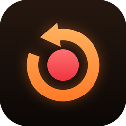
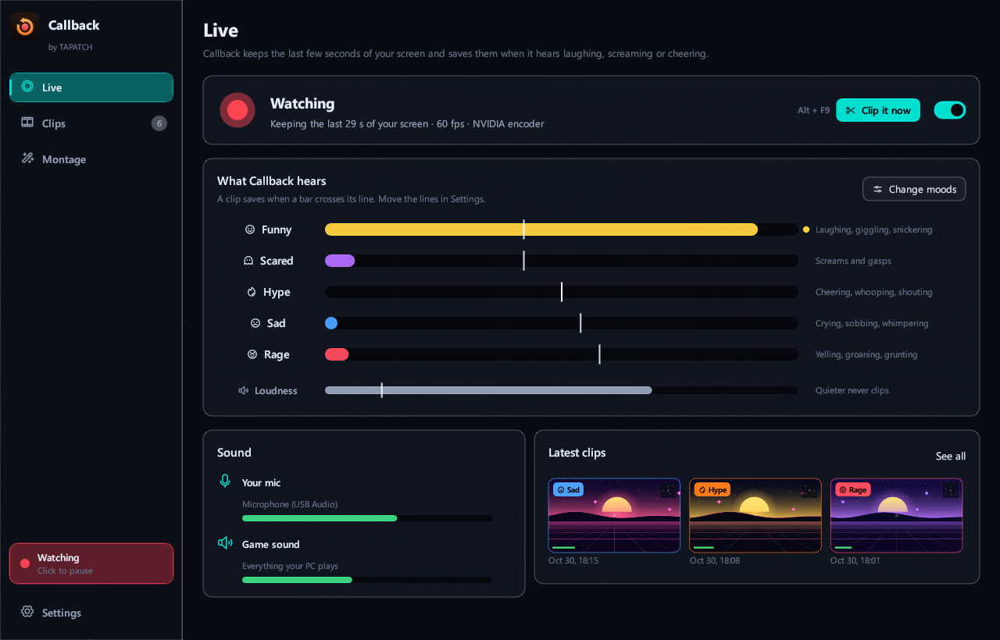
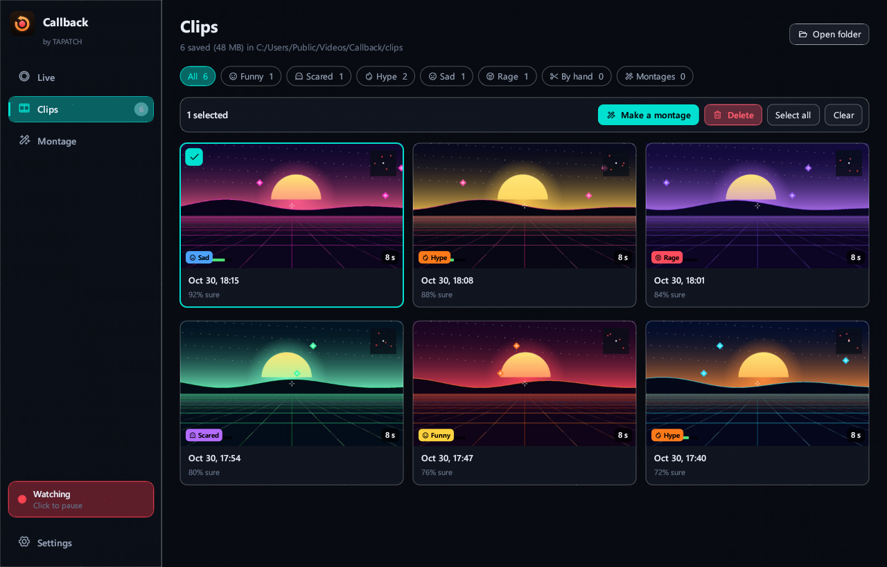
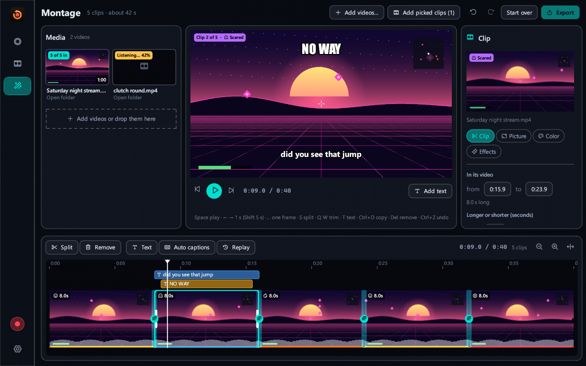
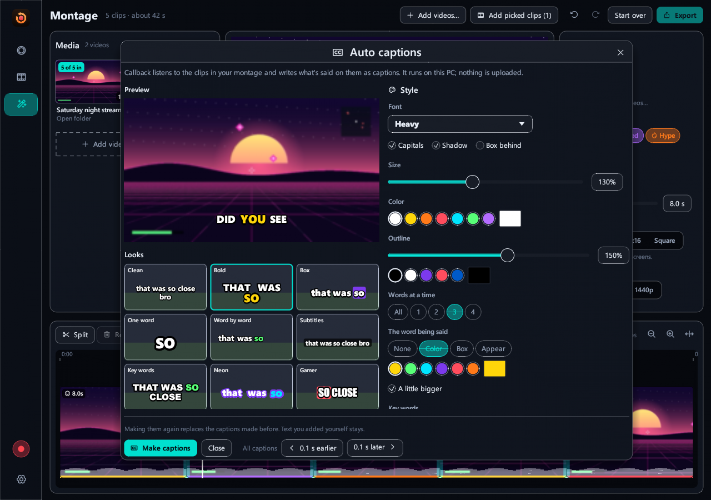
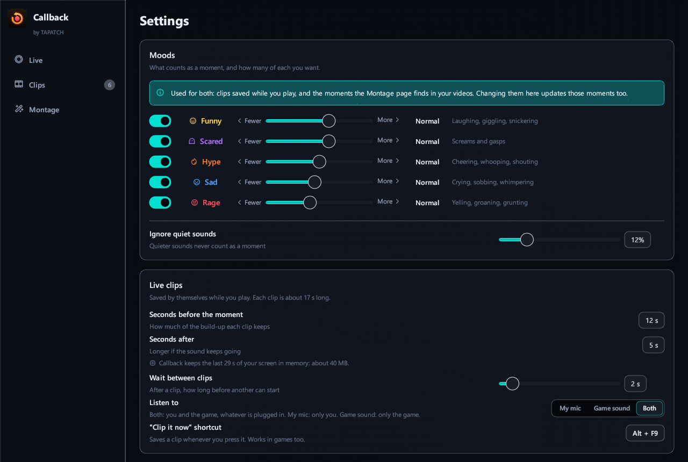

<p align="center"></p>
<h1 align="center">Callback</h1>
<p align="center"><b>Clips your best moments by itself.</b></p>
<p align="center">Game Clipper · Windows 10/11 · x64 · ~23 MB · Free for personal use</p>
<p align="center"><a href="https://github.com/tapatchUSA/Callback/releases/latest"><b>⬇ Download Callback 1.0.1</b></a> &nbsp;·&nbsp; <a href="https://tapatch.com/tools/callback/">tapatch.com/tools/callback</a></p>

<p align="center">
<br>
 <br>
 
</p>

> The best moments in a game never happen when you're ready to press record. Callback keeps the last few seconds on hand, listens for laughing, screaming and cheering, and saves the clip for you.

## What it does

Callback records your screen in the background, keeping only the last few seconds in memory, and listens to your mic and the game. When it hears a reaction (laughing, screaming, cheering, crying or yelling), it saves a clip of that moment: the seconds before it and the seconds after. Press Alt+F9 to save one yourself. Clips keep your mic and the game on separate sound tracks, plus a mix of both. Drop in your clips or any other recordings (OBS files with separate mic tracks included) and Callback finds the best moments and puts them together as a montage you can edit: trim, split, speed, volume, transitions, color, crop, zoom and position, text, word-by-word captions, music, and wide, tall or square video. If you record two screens at once, it shows the one with the game. Everything runs on your PC: recording uses your graphics card's video encoder, the sound recognition runs offline, and nothing is uploaded.

## Features

A clipper that listens, a montage maker and a video editor in one app.

**🎮 Clips itself**  
Callback hears laughing, screaming, cheering, crying and yelling, on your mic and in the game, and saves the moment. Turn each mood on or off and choose how often it clips.

**⏪ The seconds before, too**  
Your screen is kept in memory, never on disk, so every clip starts before the moment happened. Press Alt+F9 to save one yourself; press it twice for a longer one.

**⚡ No lag in games**  
Recording runs on your graphics card's video encoder (NVIDIA, AMD or Intel), at any frame rate up to 240 fps, on one screen or all of them.

**🎧 Separate sound tracks**  
With your mic and the game both on, each clip has three sound tracks: both mixed (what players and Discord play), just your mic and just the game. Auto captions can follow your voice alone, and other video editors show each track separately.

**🎬 Montages from any video**  
Drop in your clips or hours of recordings. Callback listens through them, picks the best moments and lines them up, ready to export.

**✂️ A real editor**  
Trim, split, speed up or slow down, change the volume, add transitions between clips and color looks, move, zoom, turn and crop the picture, add text and music, and export wide, tall (TikTok, Shorts, Reels) or square.

**💬 Word-by-word captions**  
Auto captions in the style of popular videos, with the word being said lit up. Pick the font, colors and look on a live sample, and which sound they follow: your mic, the game, or any tracks you tick. Speech recognition runs on your PC, in many languages.

**🖥️ Two-screen recordings**  
Recorded both monitors at once? Callback finds the screen with the game and shows just that one. Switch to the other screen or show both with one click.

## Limitations

- Windows 10/11 only. Records screens on one graphics card at a time; video that's protected from copying (some streaming apps) shows as black. Callback finds moments by their sound, so a silent moment needs Alt+F9. Auto captions download a speech model once (about 570 MB) and are fastest with a graphics card. The seconds it keeps are held in memory: the longer the clips, the more memory it uses.

## What's new in 1.0.1

- New Custom theme: pick your own accent, background, panel and text colors
- Background pictures and GIFs: add as many as you like in Settings, tick the ones to show (or Select all), and the ticked ones take turns
- Sliders set how strong the picture is and how see-through the panels are; turn it off any time
- The installer's license text matches the current Terms

Release notes for every version are on the [Releases](https://github.com/tapatchUSA/Callback/releases) page and in [release-notes/](release-notes/).

## Install

1. Download **Callback-Setup-1.0.1.exe** from the [latest release](https://github.com/tapatchUSA/Callback/releases/latest) or from [tapatch.com](https://tapatch.com/tools/callback/).
2. Run it. The installer and the app come in 10 languages.
3. Accept the Terms of Service on first launch.

Windows may show a SmartScreen warning for new downloads. Click **More info → Run anyway**.

Or with [Scoop](https://scoop.sh):

```powershell
scoop bucket add tapatch https://github.com/tapatchUSA/packages
scoop install tapatch/callback
```

## All versions

| Version | Released | Installer | VirusTotal | SHA-256 |
|---|---|---|---|---|
| [1.0.1](https://github.com/tapatchUSA/Callback/releases/tag/v1.0.1) | 2026-11-04 | [Callback-Setup-1.0.1.exe](https://github.com/tapatchUSA/Callback/releases/download/v1.0.1/Callback-Setup-1.0.1.exe) | [0 / 67](https://www.virustotal.com/gui/file/09a6d059b4663a5d2ac7aa4349d87b0e10732c4bf105f9c7d77517fd16c5dc6c/detection) | `09a6d059b4663a5d…` |
| [1.0.0](https://github.com/tapatchUSA/Callback/releases/tag/v1.0.0) | 2026-10-31 | [Callback-Setup-1.0.0.exe](https://github.com/tapatchUSA/Callback/releases/download/v1.0.0/Callback-Setup-1.0.0.exe) | [0 / 71](https://www.virustotal.com/gui/file/3a0c36c010b4ebbed6ae107393d126346dd9808d8856a2549b225d234eea6d3a/detection) | `3a0c36c010b4ebbe…` |

## Security

Every installer is scanned on VirusTotal before release. Callback 1.0.1: **0 / 67** engines flag it · [view report](https://www.virustotal.com/gui/file/09a6d059b4663a5d2ac7aa4349d87b0e10732c4bf105f9c7d77517fd16c5dc6c/detection)

**SHA-256**
```
09a6d059b4663a5d2ac7aa4349d87b0e10732c4bf105f9c7d77517fd16c5dc6c
```

## Built with

Rust · egui · Media Foundation · Direct3D 11 · YAMNet · whisper.cpp

## License

Free for personal use. Business or commercial use requires a paid license (see [tapatch.com/terms](https://tapatch.com/terms/)). Full terms: [tapatch.com/terms/software](https://tapatch.com/terms/software/).

This repository holds the official installers and release notes.

---

**[tapatch.com](https://tapatch.com)**: small tools, serious quality. Built solo, shipped with care.
