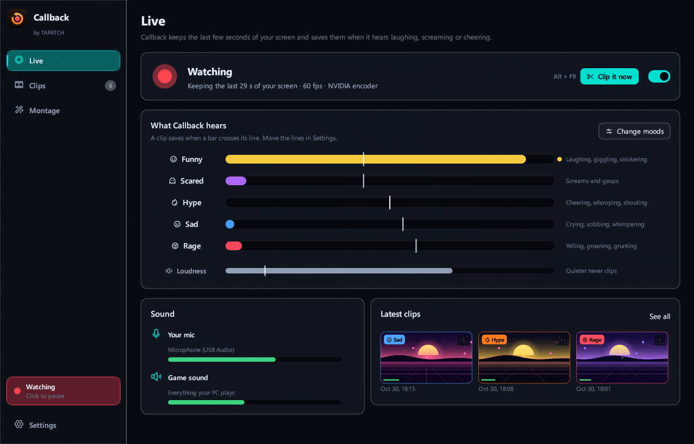
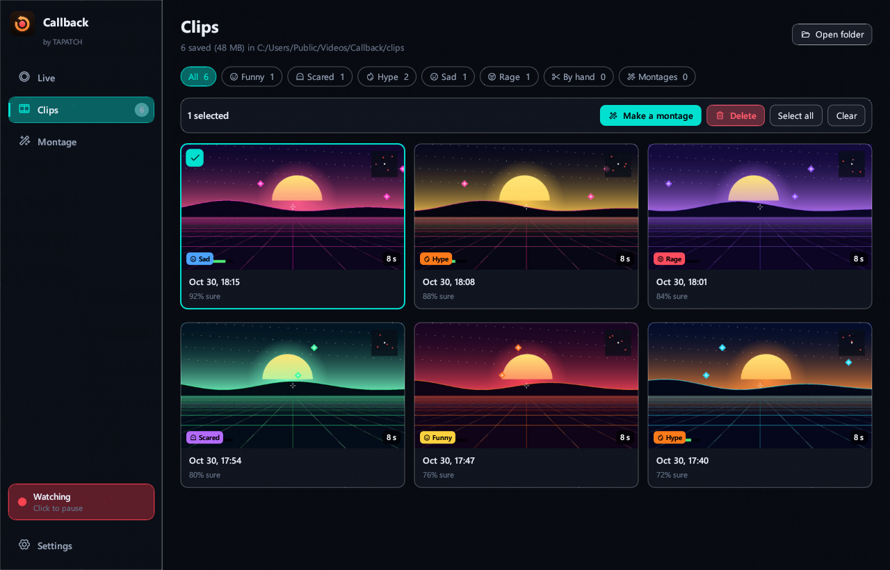
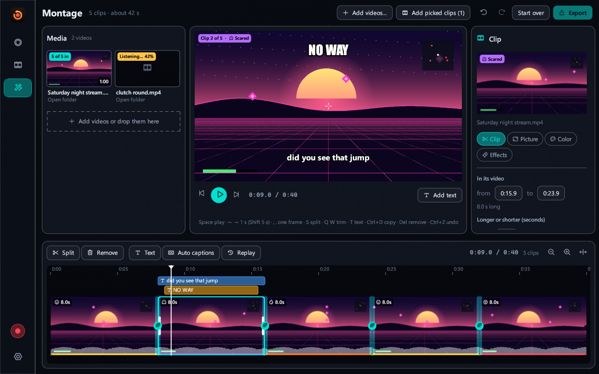
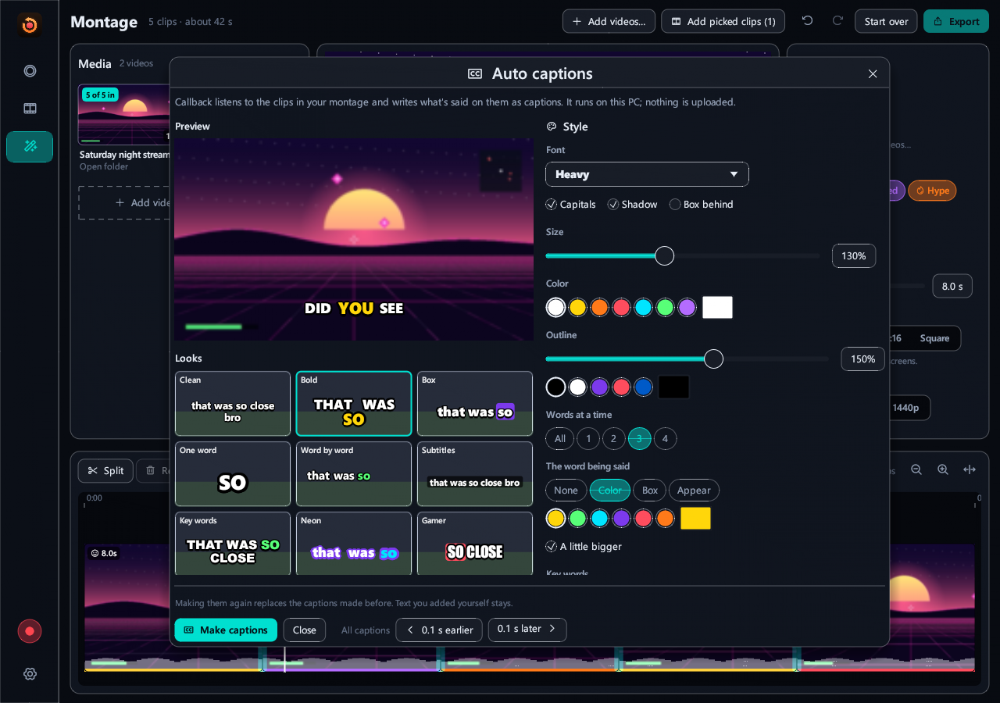
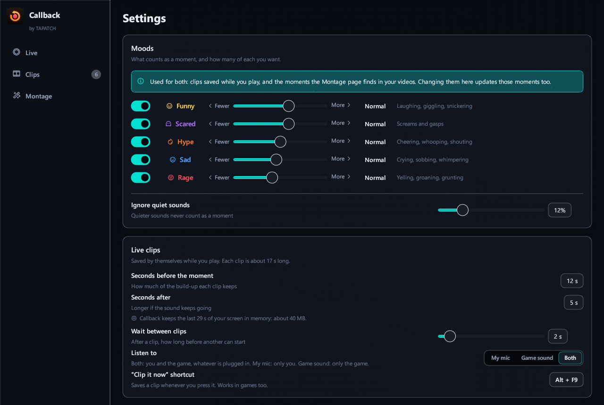

**Callback 1.0.0** for Windows 10/11 (x64) · Free for personal use

### What's new

- First release
- Saves clips by itself when it hears laughing, screaming, cheering, crying or yelling
- Records with your graphics card's encoder, any frame rate up to 240 fps, one screen or all
- Clips keep your mic and the game on separate sound tracks, plus a mix of both
- Montages from your clips or any videos, with an editor: trim, split, speed, volume, transitions, color, crop, zoom, text and music
- Word-by-word auto captions, made on your PC
- 10 languages, 4 themes

### Screenshots

 
  
 

### Download

**`Callback-Setup-1.0.0.exe`** is attached below. It is the same file as on [tapatch.com/tools/callback](https://tapatch.com/tools/callback/).

### Security

- VirusTotal: **0 / 71** engines flag it · [view report](https://www.virustotal.com/gui/file/3a0c36c010b4ebbed6ae107393d126346dd9808d8856a2549b225d234eea6d3a/detection)
- SHA-256: `3a0c36c010b4ebbed6ae107393d126346dd9808d8856a2549b225d234eea6d3a`

*First released on tapatch.com on 2026-10-31.*

---
Free for personal use. Business or commercial use requires a paid license (see [tapatch.com/terms](https://tapatch.com/terms/)).
