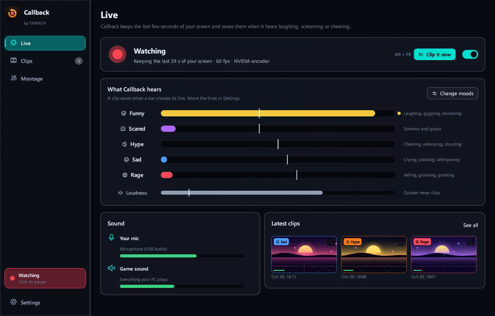
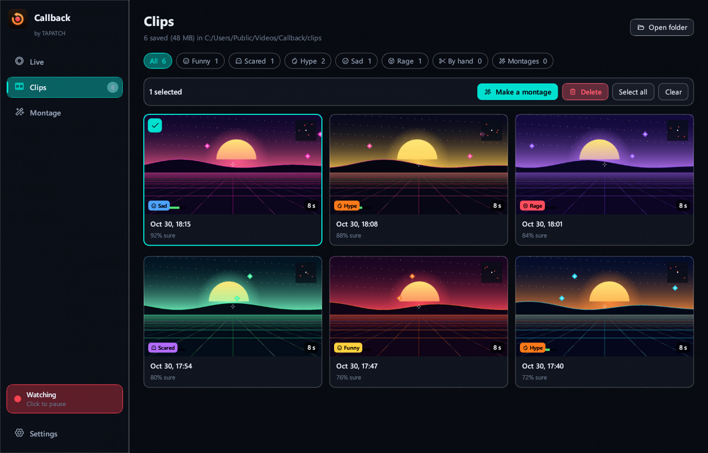
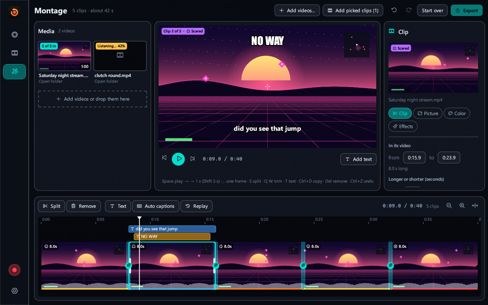
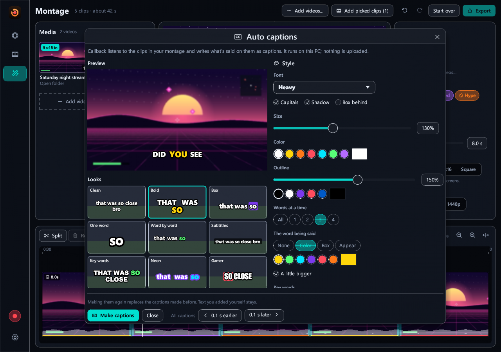
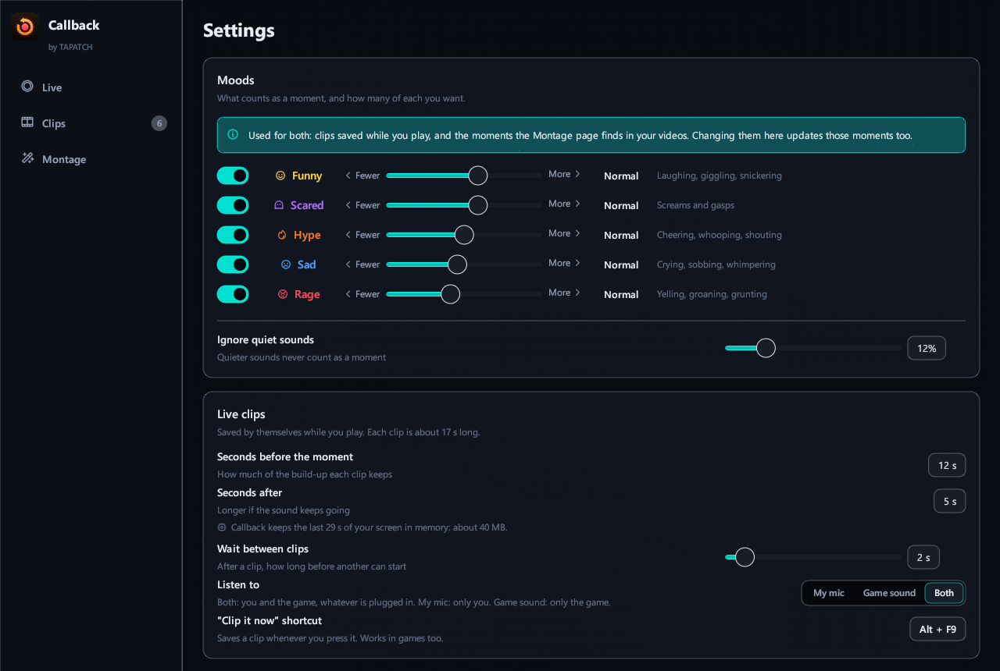

**Callback 1.0.1** for Windows 10/11 (x64) · Free for personal use

### What's new

- New Custom theme: pick your own accent, background, panel and text colors
- Background pictures and GIFs: add as many as you like in Settings, tick the ones to show (or Select all), and the ticked ones take turns
- Sliders set how strong the picture is and how see-through the panels are; turn it off any time
- The installer's license text matches the current Terms

### Screenshots

 
  
 

### Download

**`Callback-Setup-1.0.1.exe`** is attached below. It is the same file as on [tapatch.com/tools/callback](https://tapatch.com/tools/callback/).

### Security

- VirusTotal: **0 / 67** engines flag it · [view report](https://www.virustotal.com/gui/file/09a6d059b4663a5d2ac7aa4349d87b0e10732c4bf105f9c7d77517fd16c5dc6c/detection)
- SHA-256: `09a6d059b4663a5d2ac7aa4349d87b0e10732c4bf105f9c7d77517fd16c5dc6c`

*First released on tapatch.com on 2026-11-05.*

---
Free for personal use. Business or commercial use requires a paid license (see [tapatch.com/terms](https://tapatch.com/terms/)).
