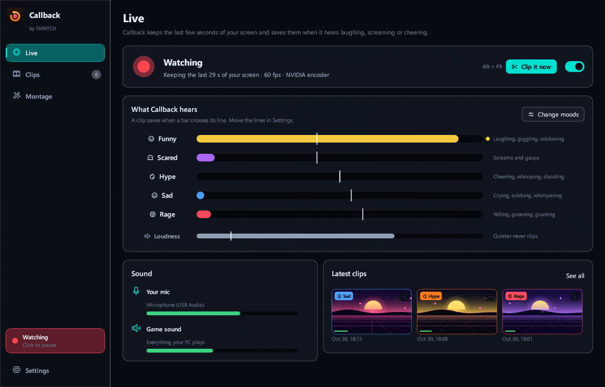
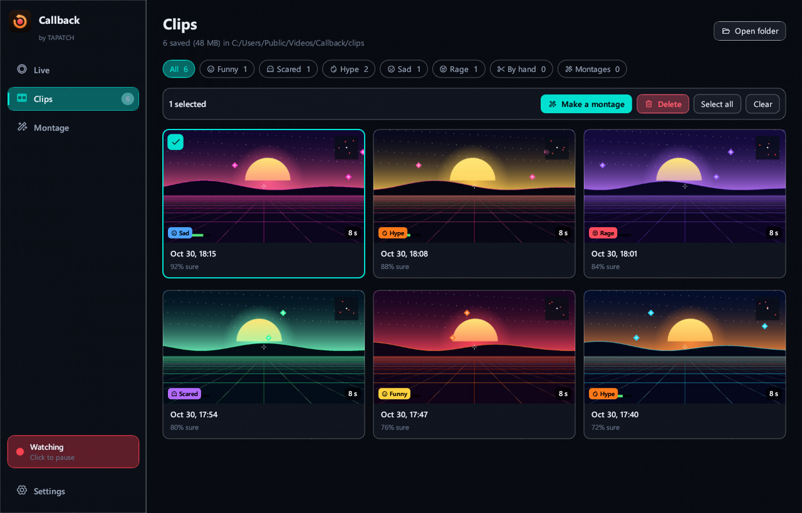
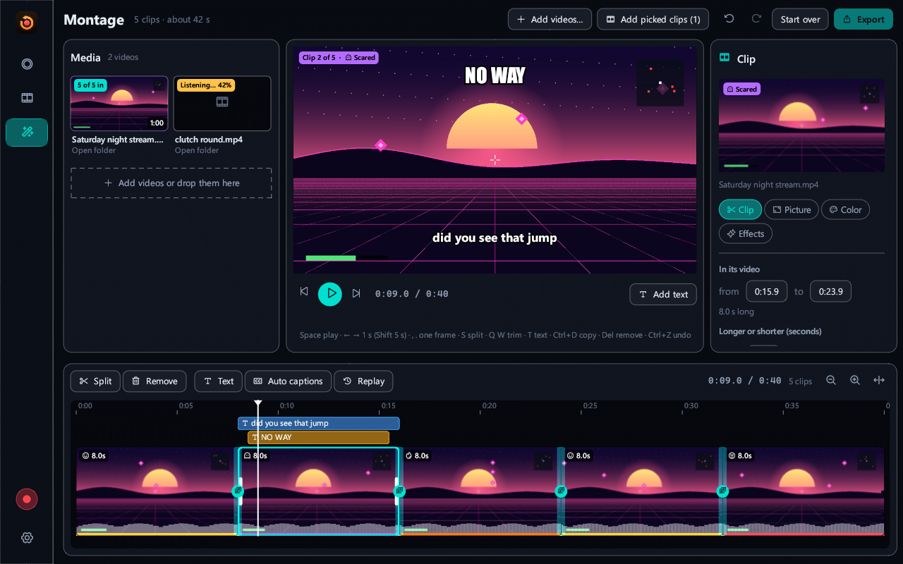
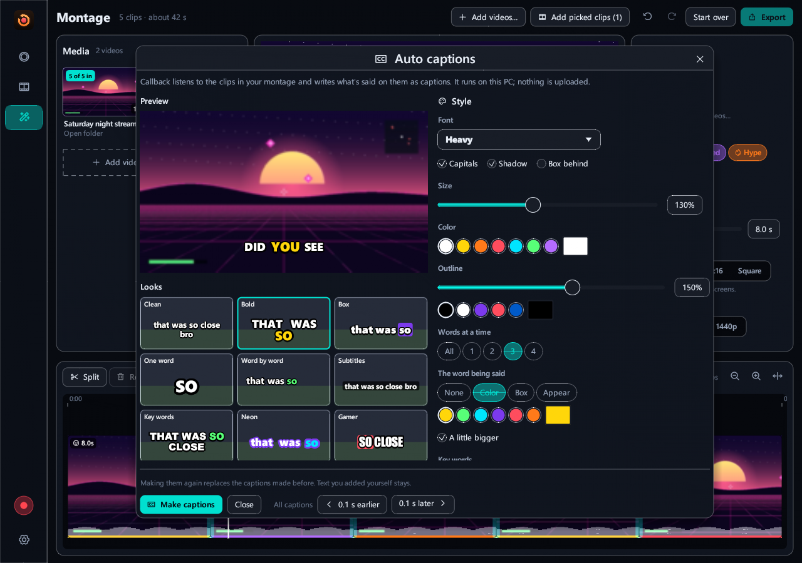
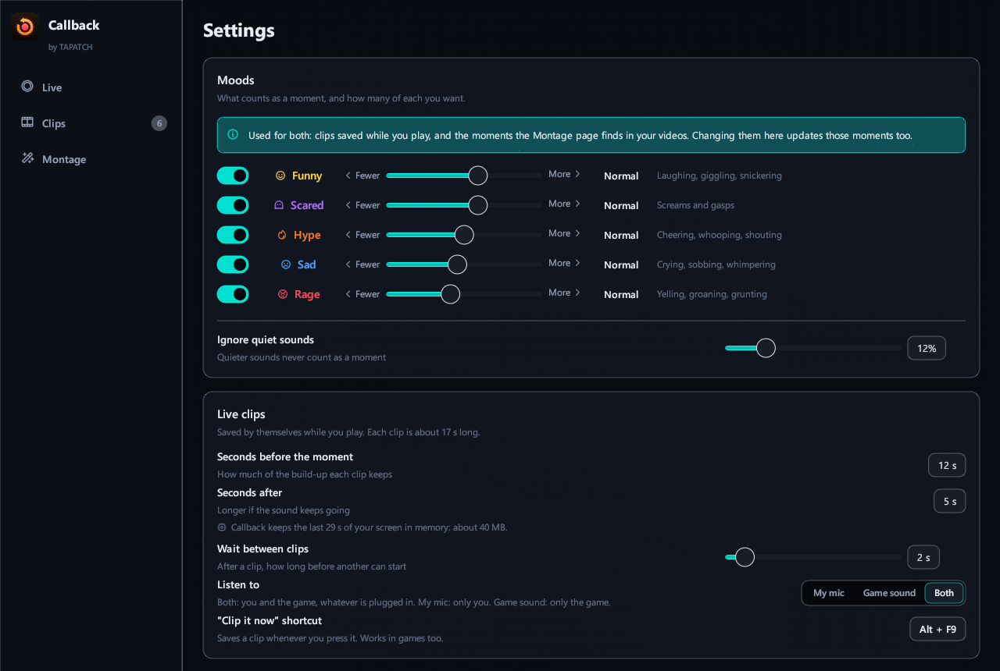

**Callback 1.0.2** for Windows 10/11 (x64) · Free for personal use

### What's new

- The English text now uses American spelling everywhere

### Screenshots

 
  
 

### Download

**`Callback-Setup-1.0.2.exe`** is attached below. It is the same file as on [tapatch.com/tools/callback](https://tapatch.com/tools/callback/).

### Security

- VirusTotal: **0 / 69** engines flag it · [view report](https://www.virustotal.com/gui/file/e11d61fe1b673231785d078919315be333afd838916192d328a2358588bd1db8/detection)
- SHA-256: `e11d61fe1b673231785d078919315be333afd838916192d328a2358588bd1db8`

*First released on tapatch.com on 2026-11-07.*

---
Free for personal use. Business or commercial use requires a paid license (see [tapatch.com/terms](https://tapatch.com/terms/)).
