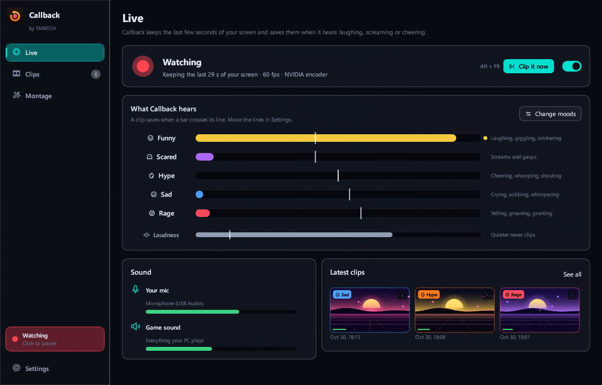
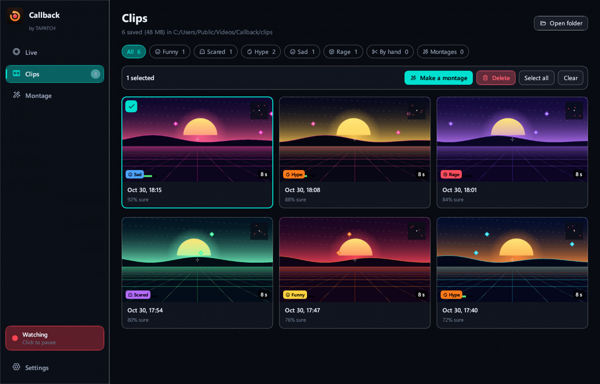
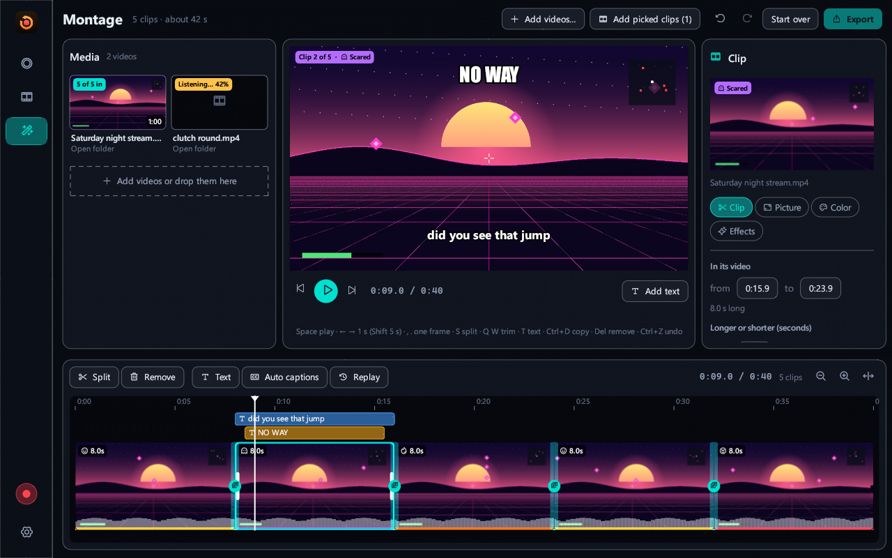
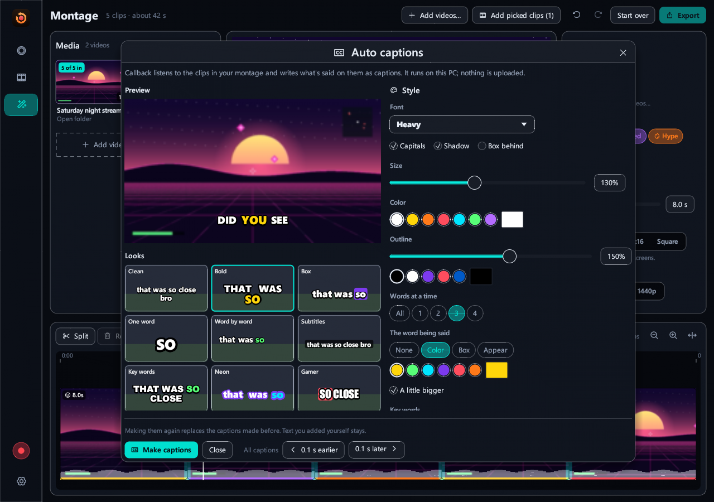
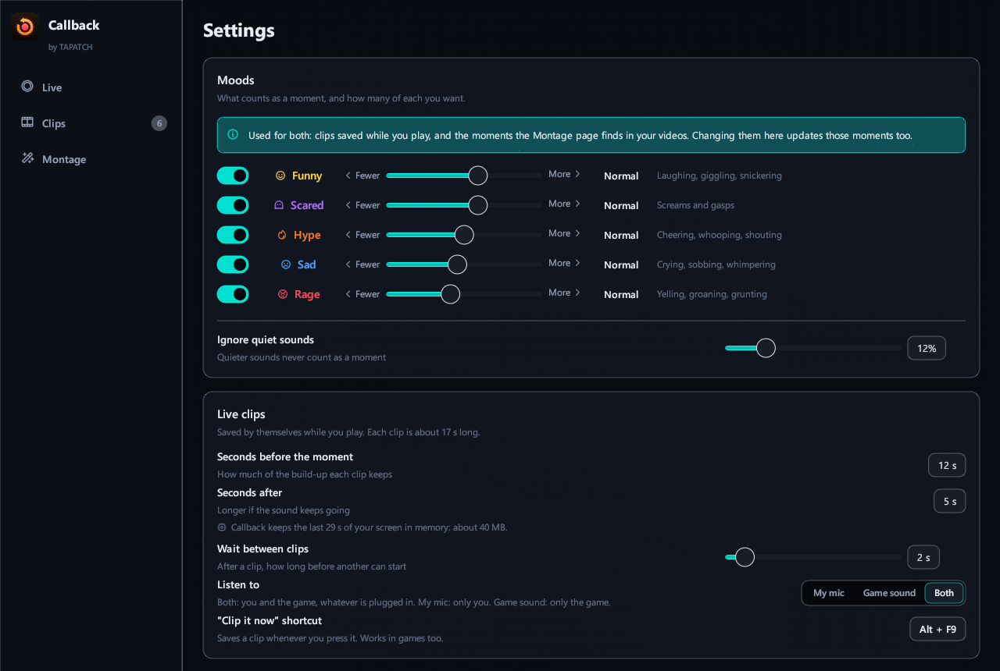

**Callback 1.0.3** for Windows 10/11 (x64) · Free for personal use

### What's new

- Now opens in virtual machines, Remote Desktop and on PCs without a graphics driver: it switches to Direct3D 12 when OpenGL doesn't work
- If the window still can't open, a message says why instead of the app closing without a word

### Screenshots

 
  
 

### Download

**`Callback-Setup-1.0.3.exe`** is attached below. It is the same file as on [tapatch.com/tools/callback](https://tapatch.com/tools/callback/).

### Security

- VirusTotal: **0 / 70** engines flag it · [view report](https://www.virustotal.com/gui/file/cd7e1639777adce12fc67241f1e70b60ed5f2f5338e0c1d79f7f9fa208dadaf5/detection)
- SHA-256: `cd7e1639777adce12fc67241f1e70b60ed5f2f5338e0c1d79f7f9fa208dadaf5`

*First released on tapatch.com on 2026-11-11.*

---
Free for personal use. Business or commercial use requires a paid license (see [tapatch.com/terms](https://tapatch.com/terms/)).
